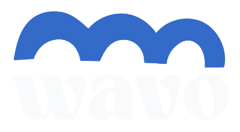

**Live Website**: [https://floppy-singers-film.loca.lt](https://floppy-singers-film.loca.lt)

# Wavo — Rave-Style Social Watch Platform & Mood-Based Media Discovery

<div align="center">
  
  <p><strong>Discover together. Watch in sync. Anywhere, on any device.</strong></p>

  <p>
    <strong>🌐 Live Deployed Website:</strong> <a href="https://floppy-singers-film.loca.lt"><strong>https://floppy-singers-film.loca.lt</strong></a>
  </p>

  <p>
    <a href="#-key-features">Key Features</a> •
    <a href="#-tech-stack">Tech Stack</a> •
    <a href="#-mobile--cross-device-support">Mobile Support</a> •
    <a href="#-quick-start">Quick Start</a> •
    <a href="#-testing--verification">Testing</a> •
    <a href="#-architecture">Architecture</a>
  </p>
</div>

---

## 🌊 Overview

**Wavo** is a modern social movie-watching and media discovery platform inspired by the synchronized experience of **Rave**, crafted with a cinematic dark aesthetic (`#08090B`, `#14161B`, warm amber `#D6A85F`, and electric blue wave accents).

Wavo allows friends to discover movies based on their current mood, test and preview playback sources *before* creating a room, and watch videos in real-time lockstep synchronization with live group chat and floating emoji reactions across desktop computers, tablets, and mobile phones.

---

## 🌟 Key Features

### 1. In-App Media Discovery Before Room Setup
- **"What do you want to watch?" Gateway**: Browse curated recommendations, trailers, local media, and search catalogs before committing to creating or joining a room.
- **Watch Now vs. Watch Together**: Preview playable content directly in the browser or instantly launch an invite-ready watch party with that title pre-loaded.
- **Never Leave the App**: Unified media cards with metadata, backdrop art, stream availability, and direct-to-player actions.

### 2. Rave-Style Synchronized Watch Parties
- **Authoritative Host Sync**: The host controls play, pause, and seek bar; all viewers stay in lockstep synchronization.
- **Drift Tolerance & Catchup**: Automatic background time-delta correction resynchronizes playback if client drift exceeds 1.5 seconds.
- **Late-Join Catchup**: New participants immediately seek to the room's current playback position upon entering.
- **Live Room Chat & Presets**: Responsive real-time chat with fast tap presets (*"Let's start! 🍿"*, *"Pause a sec"*, *"Best scene so far!"*).
- **Floating Emoji Bursts**: Animated live reactions (🔥, ❤️, 😂, 🍿, 😱, 👏, ✨, 🤯) erupting over the video in real time.
- **QR Code Camera Pairing**: Desktop hosts can pop up a high-contrast QR code for friends on phones to scan and join instantly.

### 3. Dedicated Media Browser & Universal Video Player
- **Universal Video Player**: Unified playback engine handling both online streaming embeds and client-side media files with custom cinema controls, scrub bars, volume slider, and fullscreen modes.
- **YouTube IFrame API Adapter**: Stream trailers and embed-eligible YouTube videos in-app with synchronized controls.
- **Safe Commercial Streaming Adapters**: Clear, honest DRM-compliant guidance for Netflix, Prime Video, Disney+, and Apple TV with session sync notes—never pretending to bypass DRM or breaking in iframes.
- **Local Movie & Downloads Player**: Play personal `.mp4`, `.webm`, or `.mkv` files directly in the browser with zero server upload needed.

### 4. Full Mobile & Android Chrome Experience
- **Progressive Web App (PWA)**: Installable to the Android home screen via `manifest.json` and client-side `beforeinstallprompt` banner.
- **Safe-Area Inset Support**: Designed for modern notched screens and navigation bars (`env(safe-area-inset-*)`).
- **Autoplay Resilience**: Gracefully handles mobile browser autoplay blocks with a one-tap touch overlay.
- **Native Phone File Picker**: Automatically detects mobile environments and opens native file selection for Downloads and Gallery items.
- **Background Resync**: Automatically catches up playback state when a phone screen is unlocked or a Chrome tab is refocused (`visibilitychange`).

### 5. Emotional Mood Recommendation Engine
- **12 Curated Moods**: Happy, Sad, Stressed, Romantic, Lonely, Adventurous, Curious, Nostalgic, Scared, Inspired, Bored, and Surprise Me.
- **Resonance Notes**: Explains *why* each movie matches the user's emotional state.
- **Granular Filters**: Filter by runtime (<90m, 90–120m, 2h+), genre, vibe (Popular, Underrated, Hidden Gem), and language.

### 6. Authentication & User Profiles
- **Cinematic Auth Modal**: Sign in with Google (OAuth), Email/Password, or explore friction-free as a Guest.
- **Profile Preferences**: Customizable avatar, display name, favorite moods, and connected streaming services.
- **Personal Watchlist**: One-click bookmarking and watch status tracking.

---

## 🛠️ Tech Stack

- **Framework**: Next.js 14.2 (App Router)
- **Language**: TypeScript (Strict mode)
- **Styling**: Tailwind CSS with custom cinematic dark theme
- **Icons**: Lucide React
- **Backend / Realtime**: Supabase (PostgreSQL, Row-Level Security, Realtime channels) with local event bus fallback
- **Video API**: YouTube IFrame Player API + HTML5 Media API
- **Testing**: Vitest (30 automated unit and integration tests across 7 suites)

---

## 🚀 Quick Start

### 1. Clone & Install
```bash
git clone https://github.com/lucky0001-vk/wavo.git
cd wavo
npm install
```

### 2. Configure Environment Variables
Copy `.env.example` to `.env.local`:
```bash
cp .env.example .env.local
```
*(Optional: Wavo runs out of the box with offline curated catalog and local transport fallbacks even without API keys!)*

### 3. Run Development Server
```bash
npm run dev
```
Open [http://localhost:3000](http://localhost:3000) in your browser.

### 4. Run Automated Tests
```bash
npm test
```

### 5. Production Build
```bash
npm run build
npm start
```

---

## 📱 Mobile Access (Local Network & Public HTTPS)

To test on your Android phone or share with friends across devices:
- **Local Wi-Fi**: Start with `npm start -- -H 0.0.0.0 -p 3000` and visit `http://<your-lan-ip>:3000`.
- **Public HTTPS Tunnel**: Run `npx localtunnel --port 3000` to share a public link accessible from any mobile cellular network.

---

## 📄 License

MIT © [lucky0001-vk](https://github.com/lucky0001-vk)
